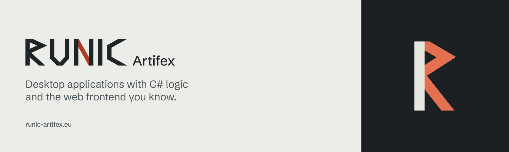

# Runic Artifex Website

The static marketing site for the Runic SDK products, served at
`https://runic-artifex.eu`.
Built with SvelteKit, Svelte 5, and `@sveltejs/adapter-static`.

## Develop and verify

Use Node from `.node-version` and Bun from `package.json`:

```sh
bun install --frozen-lockfile
bun run dev
bun run lint
bun run check
bun run test
```

`bun run test` builds the site and checks the rendered routes and links. After dependencies are installed, builds need no network access or sibling repository. On NixOS in the shared workspace, reuse the locked application SDK environment with `direnv exec ../runic-sdk bun run test`.

Run `bun install --frozen-lockfile` separately in `docs/`, then use
`bun run docs:check` and `bun run docs:test` from this repository root.
The two applications have separate locks and CI artifacts; neither requires
building product SDK packages. See the [ownership and cutover plan](docs/plans/documentation-ownership.md).

Changes reach `main` only through pull requests that pass the `verify` check;
see [CONTRIBUTING.md](CONTRIBUTING.md). Report vulnerabilities as described in
[SECURITY.md](SECURITY.md).

## Maintain content

The homepage explains what Runic does, shows it working, and links into the
documentation. Update product names, descriptions and links in
`src/lib/products.ts`. The first screen shows the application template's
counter page: `src/lib/seam.ts` holds excerpts of its C# ViewModel and of each
frontend, so update them when the template's counter page changes.

Installation details, package availability, and portal guides live in
[docs/](docs/README.md), published at
[docs.runic-artifex.eu](https://docs.runic-artifex.eu/). Package READMEs,
specifications and canonical Translations guides remain product-owned and are
linked from the portal. The marketing site has no generated release or CI
state to synchronize.

## Brand

The palette, fonts, wordmark and product glyphs come from
[runic-brand](https://github.com/Runic-Artifex/runic-brand), whose guidelines
explain the system. Its sync script writes `src/lib/brand/tokens.css`,
`src/lib/brand/marks.json`, `static/brand/marks/`, `static/favicon.svg`,
`static/icon.png` and `static/og.png` here, and the same files under `docs/`.
Do not edit those files by hand; change the brand source and run
`npm run sync:workspace` in `runic-brand`.

## Deployment contract

- `runic-artifex.eu` serves the static `build/` output from this repository.
- `www.runic-artifex.eu` redirects permanently to the apex origin.
- `docs.runic-artifex.eu` serves the independent `docs/build/` output from this repository.
- `/schemas/translations/*` on the apex is included in root `build/` by deterministically mirroring the portal's pinned Translations schemas (currently Runic Translations 0.8.0) plus retained legacy schemas such as `editor-state-v1`, which a newer pin no longer ships but whose URL stays published. Preserve these public schema URLs when changing deployments.
- `/ci/` remains a lightweight link to SDK Actions for existing bookmarks.

## License

MIT.
